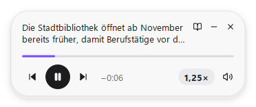
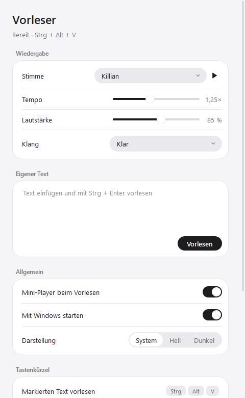

# TTS Vorleser

Markierten Text in jedem Windows-Programm per Tastenkürzel vorlesen lassen, mit einer natürlich
klingenden deutschen Stimme. Text markieren, **Strg + Alt + V** drücken, zuhören. Gedacht für
lange Artikel, PDFs und Dokumentation, die man lieber hört als liest.

<p>
  
  
</p>

## Funktionen

- Liest aus jedem Programm vor: Browser, Word, PDF-Reader, Editor
- Mini-Player mit aktuellem Satz, Fortschritt, Satz vor/zurück und Spulen
- Leseansicht mit dem ganzen Text, in der das gesprochene Wort mitläuft
- Tempo von 0,7× bis 2×, ohne dass die Stimme höher wird
- Startet in etwa einer halben Sekunde, weil die Audiodaten schon während der Erzeugung abgespielt werden
- Läuft im Infobereich, Tastenkürzel frei belegbar, helles und dunkles Design

## Wie es funktioniert

Die Sprache kommt von der Vorlesefunktion des Microsoft-Edge-Browsers (über
[edge-tts](https://github.com/rany2/edge-tts)), Standardstimme ist Killian. Alles andere läuft lokal:

- **Textaufbereitung** (`text_cleaner.py`): Abkürzungen, Datumsangaben, Zahlen, Einheiten und
  kopierte PDF-Zeilenumbrüche werden in sprechbaren Text umgewandelt. Englische Fachbegriffe wie
  „README“ oder „Backend“ bekommen eine Schreibweise, die die deutsche Stimme englisch ausspricht.
  Gefunden habe ich diese Schreibweisen, indem ich jedes Wort sprechen ließ und mit Whisper
  geprüft habe, was man tatsächlich hört.
- **Audio** (`audio_player.py`): Streaming-Wiedergabe, Resampling, ein leichter Klangfilter und
  Pegelausgleich zwischen den Stimmen.
- **Oberfläche** (PySide6): Infobereich, Mini-Player, Leseansicht und Einstellungen. Der markierte
  Text wird über die Zwischenablage geholt, deren alter Inhalt danach wiederhergestellt wird.

Ausprobiert und wieder verworfen habe ich ein lokales Sprachmodell (Ming-TTS) und ElevenLabs.
Im direkten Hörvergleich klang keins besser als Killian, und beide waren langsamer.

## Installation

Voraussetzungen: Windows 10/11, [uv](https://docs.astral.sh/uv/), PowerShell und .NET Framework 4.x
(für den Starter, bei Windows dabei).

```powershell
git clone https://github.com/NicoDev01/local_tts_reader.git
cd local_tts_reader
.\setup.ps1
```

Das Skript richtet Python 3.12 mit festen Paketversionen ein, baut einen kleinen Starter ohne
Konsolenfenster und legt eine Desktop-Verknüpfung an.

## Tests

```powershell
.venv\Scripts\python.exe -B -m unittest discover -s tests
```

## Gut zu wissen

- Der markierte Text wird zur Spracherzeugung an Microsoft übertragen.
- edge-tts nutzt eine inoffizielle Schnittstelle. Ändert Microsoft sie, kann ein Update nötig werden.
- Nur Windows, und auf deutsche Texte ausgelegt.

Mehr zu Bedienung, Aufbau und Messungen: [docs/details.md](docs/details.md)

## Lizenz

[MIT](LICENSE)
